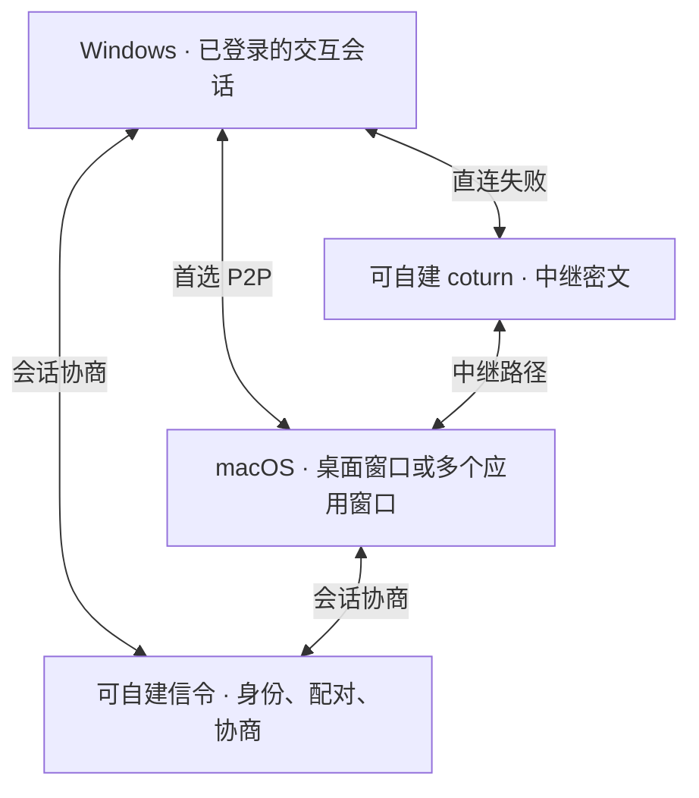

# 远程 Windows 窗口融入 macOS · 总体架构

**选型与商业边界｜2026-11-20｜对应开发文档：`02-implementation.md`**

## 1. 项目怎么做

一台真实 Windows PC 上已经打开了编辑器和浏览器。用户在 Mac 上先看到整张远程桌面，点「融合模式」，选中这两个窗口，就能把它们分别放在 Finder 左右。拖动 Mac 窗口改变本地布局，编辑内容仍作用在 PC 上原来的进程。切回整屏后，两个应用和未保存的内容都还在。剪贴板、文件传输和端口转发属于连接本身，切换视图时继续工作。

**推荐组合是 Petal 的逐窗采集与接收端显示、一个原生 WebRTC 双端连接、可自建的信令服务和 coturn。** ManyDesk 提供已经能读到实现的整屏远控、剪贴板、文件与 TCP 转发参考。先用原版 Petal 验证最难的 Win→Mac 交互，再将窗口模块接入一对一传输。这能较早验证用户真正会感受到的差异，也保留对 Relay 成本与许可的控制。[Petal 架构][pa] · [其底层 PeerConnection 接口][pc] · [ManyDesk][many] · [coturn][cot]

在本轮核查的项目中，**没有核实到一个能直接满足全部要求的成品**。最接近窗口体验的是 Petal 和 WinFleet。前者采用会议 SFU，后者依赖虚拟显示器。最接近完整远控底座的是 ManyDesk；其固定版本的中继实现明确拒绝 TCP 和 TLS，仅替换服务器解决不了企业网络禁用 UDP 的场景。[Petal 验证边界][pv] · [WinFleet][wf] · [ManyDesk 中继解析器][mt]

## 2. 开源项目逐项选型

| 项目及本轮依据 | 已核到的能力 | 对本产品的决定 |
|---|---|---|
| **[Petal][pa]** · Apache-2.0 自有代码 | Windows WGC 按窗口捕获，Mac 每个远端窗口建立独立的无边框 NSPanel；有逐窗控制授权、输入和定向文本复制/粘贴 | 优先抽取窗口两端和授权逻辑。当前 LiveKit SFU 连接要替换；Windows 端仍在开发。独立 Dock 图标、远端窗口跟随缩放、全局剪贴板同步均须另验。 |
| **[ManyDesk v0.25.10][mr]** · Apache-2.0 自有代码 | 实体 Windows 控制台、DXGI 整屏、Mac 客户端、双向文件和剪贴板、从 Mac 本地发起的 TCP 转发、QUIC 直连与自配 TURN/UDP。上游该提交有 Mac 测试及 Windows 交叉构建记录。[网络实现][mt] · [TCP 转发][mf] · [CI][mc] | 远控功能参照，优先移植能与网络解耦的逻辑。原版默认使用公共 Nostr/MQTT 发现，视频帧头亦缺少窗口 ID。采用主方案时不把原生 QUIC 会话嵌进 WebRTC。[信令][ms] · [帧头][mh] |
| **[WinFleet][wf]** · 编排代码 MIT | 已有「真实 Windows 当前会话 → Mac 独立窗口」，可做独立 Dock 入口及跟随缩放。每个应用被移到虚拟显示器，每屏一个 Sunshine 实例，Mac 的 Moonlight 裁剪画面 | 最适合对照交互效果。虚拟显示驱动、Sunshine、经修改的 Moonlight 各有分发条件。正常启动路径含强制结束同名进程的逻辑，做体验对照应使用无未保存内容的测试应用。[窗口放置源码][wplace] |
| **[QuickDesk][qd]** · 自有代码 MIT | Win/Mac、P2P、自建信令及 TURN、文件和音频。构建默认引入单独仓库的 Chromium Remoting 预构建包 | 想保留 Qt/C++ 整个远控产品时的候选。逐窗采集、多视频轨和通用端口转发仍需验证或开发；修改底层的构建成本和 Qt 模块许可需单独核算。[构建入口][qbuild] |
| **[RustDesk][rustdesk]** · 社区客户端和基础服务器 AGPL-3.0 | 成熟的整机远控，自建发现与中继，剪贴板、文件和 TCP 转发。未核实到本需求的同会话逐窗模式 | 用作功能与网络体验基准。直接派生、分发社区代码通常须履行其许可证，无法单方把继承代码改成「企业必须买许可」。另谈上游授权是不同的商业安排。[服务端][rustserver] · [AGPL 原文][agpl] |
| **[FreeRDP][fr] / [IronRDP][ir] / [RemoteApp Tool][rat]** | RAIL 有窗口创建、所有者、位置和本地呈现模型；IronRDP viewer 有实际创建本地窗口的代码 | 可参考窗口协议，或另做「发布 Windows 应用」产品。RAIL 的窗口属于相应 RDP 会话，无法由此推断可以无损接手物理控制台里的任意既有窗口。生产部署还取决于 Windows 版本和授权。[微软 RAIL 规范][rail] |
| **[Xpra][xp] / [Vitrine][vc]** | Xpra 成熟的 seamless 主要面向 X11，Windows 指定窗口 shadow 具有实验性质。Vitrine 的 Windows 实现采整屏，在 Mac 按区域裁剪 | 可研究遮挡、几何和窗口生命周期。桌面裁剪在远端叠窗时可能带出另一个窗口的像素，不选为逐窗隐私边界。[Xpra 工作单][xpi] · [Vitrine 采集源码][vg] |
| **[DeskVNC][dv] / [MeshCentral][mesh]** | DeskVNC 分开实现多种连接协议，但其导入器明确拒绝 RemoteApp 类型的 RDP 文件。MeshCentral 有桌面、文件、WebSocket 中继及 WebRTC 直连升级设计 | 可参考运维或远控功能。未核实到这些项目能把当前 Windows 会话逐窗映射为原生 Mac 窗口；撤回此前对 DeskVNC 成品能力的推断。[DeskVNC 解析器][dvp] |

## 3. 一次连接，两种视图

| 层 | Windows 被控端 | macOS 控制端 | 服务端 |
|---|---|---|---|
| 视图 | 通过 DXGI 或 WGC 显示器源采整屏；融合时为每个获准窗口建立 WGC 源 | 一个桌面窗口或多个 AppKit 窗口，按轨道分别解码显示 | 不参与窗口选择、视频解码和合成 |
| 窗口与输入 | 在已登录用户会话内维护窗口注册表，处理创建、销毁、焦点、DPI 和输入，保留物理用户撤权能力 | 稳定关联窗口与视频，接收键鼠、滚轮和文本，显示远端对话框；本地布局独立 | 信令处理会话建立；逐窗事件走端点之间的加密控制通道 |
| 通用远控 | 系统剪贴板、文件读写、授权目标的 TCP 连接、可选系统声音采集 | 双向复制粘贴、文件面板和拖放、本地端口监听、可选音频播放 | 直连时不转发内容；被选用的 TURN 节点仅转发已加密的传输数据 |
| 身份与商业 | 校验设备、授权范围、用户撤销；企业端点离线验签 | 显示「直连／自建中继／官方中继」，区分企业软件许可与云订阅 | 开源自建包提供完整配对、信令和短期中继凭据；官方另加账户、配额、账单和运维 |

**连接语义。** 同一次连接保留一组控制与数据通道。切换模式改变授权画面源、订阅和本地窗口。融合窗口默认只在 Mac 上移动；调整远端尺寸、关闭远端应用、把其它窗口加入共享，都有明确操作。关闭本地查看窗口默认解除展示，远端应用继续运行。全局键盘输入需要当前 Windows 前台目标与获准目标一致，无法确认时暂停输入。[Windows 前台限制][fg] · [SendInput 与完整性级别][inp]

**产品承诺。** 首版支持标准用户已经登录的 Windows 11 x64 桌面与 Apple Silicon Mac。一名控制者，多个窗口。普通 TCP 本地转发、双向文件与文本剪贴板是首版要求。系统声音、多显示器和 macOS 混合 DPI 有单列验收；图像剪贴板和逐应用独立 Dock 图标分步交付。UAC 安全桌面、锁屏、受保护内容和长期无人值守登录应在状态栏明确反馈。双向复制文字与「企业内的文件/端口权限」可分别授权。远端最小化时允许冻结或暂停，不承诺后台持续渲染。

**托管拓扑。** 一对一连接使用 WebRTC 的 ICE 和端点间的 DTLS-SRTP / SCTP。局域网和公网先尝试可达直连，再选 TURN；全程禁 UDP 的网络需单独验收客户端经 TURN/TLS 与中继通信。TLS 443 能否通过仍受代理策略影响。SFU 适合多人会议，会改变单次会话的带宽成本、信任模型和计费方式；原版 Petal 的 SFU 仅用于早期对照。[ICE][ice] · [WebRTC 安全架构][wsec] · [数据通道][dc] · [coturn][cot]

## 4. 免费自建、付费托管、企业许可怎么共存

这里采用的业务解释是：**任何人及公司都可以免费部署服务器；个人非商业使用完整端点免费；公司用我们的端点开展业务，需要购买端点许可。** 免费指不向项目方交软件费，机器、证书运维及网络流量由部署者承担。公司若使用独立实现的客户端，仅运行开源 Relay，不产生我们的端点许可费。

| 使用者与部署 | 自建服务端软件费 | 我们的 Windows / Mac 端点 | 官方托管 Relay |
|---|---:|---|---|
| 个人非商业，全自建 | 0 | 全部功能免费 | 无需订阅，无需官方账户 |
| 个人非商业，用官方中继 | 不适用 | 全部功能免费 | 按订阅或流量付费 |
| 公司商用，全自建 | 0 | 购买商业许可，支持离线授权 | 0 |
| 公司商用，用官方中继 | 不适用 | 购买商业许可 | 托管另计，可打包销售 |
| 第三方仅部署或运营开放服务器 | 0 | 未使用我方端点就不产生该项费用 | 不使用官方服务就无此项费用 |

**仓库与许可。** 自研信令、设备配对服务、凭据签发、自建部署文件以及协议规范建议 Apache-2.0。coturn 按其 BSD-3-Clause 原条款分发。两者都允许企业运行、修改，也允许别人经营兼容中继。将有权授权的端点增量以「源码公开的非商业许可 + 独立商业许可」提供；保留复用组件的原始许可证、版权和必要声明。对外可以写「服务端开源，客户端源码可见，个人非商业免费」。若将完整端点也按 OSI 开源许可证发布，企业同样可以依该许可证免费使用，此时能够收费的是官方托管、支持、附加企业模块或可选的替代许可。[OSI 定义第 5、6 条][osi] · [Apache-2.0][apache] · [coturn 许可证][cotlic]

**签约前的三个实际问题。** 第一，定义谁需要付费：公司内部办公、个人接单、学校横向课题、公益机构和试用期。PolyForm Noncommercial 可作为候选文本，但其列明了教育、政府等组织的例外，必须与实际政策逐项对齐。第二，保证自研部分有商业再许可权，纳入第三方贡献前明确授权；DCO 签署本身不能替代该项授权。第三，针对**实际交付的二进制**核许可证、商标和编解码专利，并按发行地区审查商业合同。Windows 及远端应用原有授权仍适用；日后出售 Windows Server 多用户云桌面需另做 RDS/CAL 审查。[PolyForm 原文][poly] · [DCO][dco] · [微软 RDS 授权说明][rds]

**Relay 收费口径。** 首发优先做托管订阅和明确的套餐流量。直连和自建中继不进入官方中继用量。使用官方信令、做一次 STUN 探测或成功分配 TURN 凭据都不足以产生转发费用。控制面开通订阅，数据面以实际中继转发和服务端记录核账。自建路径保留全部基础服务，断开官方域名仍能运行。

## 5. 已验证到哪一步

| 证据层级 | 本轮结果 |
|---|---|
| 固定提交源码 | 读了 Petal 的 Windows WGC、Mac 合成器、远控、第三方声明及底层 PeerConnection；ManyDesk 的 TURN 解析、网络发现、剪贴板、视频帧结构和 TCP 监听；WinFleet 的窗口迁移；DeskVNC 的 RemoteApp 导入判断。 |
| 实际执行 | 在 Linux / Node 24.22.3 运行了固定版 Petal 的 **11 个原始窗口协议测试体，11/11 通过**。三份原始输入文件的 Git blob 哈希与上游一致。覆盖轨道命名、源类型、缩放、层级、标题、URL 和色彩元数据。 |
| 未获得的证据 | 本次没有 Windows 与 Mac 双机，也没有可运行的 TURN 服务端；本地 WebRTC 浏览器探针在浏览器启动阶段受环境套接字限制。没有测得真实逐窗画面、输入正确率、P2P 打洞成功率、TURN/TLS 可达率或时延。 |
| 发布判断 | 文档中的协议、计费和性能数字都是设计或验收目标。两台真机、两个独立网络、一个自建中继以及明确的二进制许可证清单，是作出可商用交付承诺前的四项证据。 |

[pa]: https://github.com/kiruna-labs/petal/blob/7c3b34fd8ad76c838ffb1667893ed55b0387f1b3/docs/ARCHITECTURE.md
[pv]: https://github.com/kiruna-labs/petal/blob/7c3b34fd8ad76c838ffb1667893ed55b0387f1b3/docs/VALIDATION.md
[pc]: https://github.com/kiruna-labs/petal/blob/7c3b34fd8ad76c838ffb1667893ed55b0387f1b3/apps/desktop/vendor/libwebrtc/src/peer_connection.rs
[many]: https://github.com/manydesk/many-desk
[mr]: https://github.com/manydesk/many-desk/releases/tag/v0.25.10
[mc]: https://github.com/manydesk/many-desk/actions/runs/44545748184
[mt]: https://github.com/manydesk/many-desk/blob/5bf1897062e69fd48ee82cb5ac6c4bbfdf14c31d/app/src/mdp/turn.rs#L203-L212
[mf]: https://github.com/manydesk/many-desk/blob/5bf1897062e69fd48ee82cb5ac6c4bbfdf14c31d/app/src/core/tunnel.rs#L28-L47
[ms]: https://github.com/manydesk/many-desk/blob/5bf1897062e69fd48ee82cb5ac6c4bbfdf14c31d/app/src/rendezvous.rs#L26-L44
[mh]: https://github.com/manydesk/many-desk/blob/5bf1897062e69fd48ee82cb5ac6c4bbfdf14c31d/app/src/mdp/session.rs#L3-L13
[wf]: https://github.com/zorahrel/winfleet
[wplace]: https://github.com/zorahrel/winfleet/blob/6e5b1565f6498eb855f1f0a0f69860ef15902b62/host/wf-place.ps1#L221-L247
[qd]: https://github.com/barry-ran/QuickDesk/blob/fed250086ae5d529076dc88940675021155374a3/README.md
[qbuild]: https://github.com/barry-ran/QuickDesk/blob/fed250086ae5d529076dc88940675021155374a3/cmake/quickdesk-remoting.cmake
[rustdesk]: https://github.com/rustdesk/rustdesk
[rustserver]: https://github.com/rustdesk/rustdesk-server
[fr]: https://www.freerdp.com/2026/11/02/3_33_0-release
[ir]: https://github.com/Devolutions/IronRDP/blob/a8da54ba4d849370bc92e1d5230cc18e99cf5ff1/crates/ironrdp-viewer/src/rail.rs
[rat]: https://github.com/kimmknight/remoteapptool
[rail]: https://learn.microsoft.com/en-us/openspecs/windows_protocols/ms-rdperp/ead02bce-64ef-41d6-aa06-8565956b9fe7
[xp]: https://github.com/Xpra-org/xpra/blob/master/docs/Usage/Seamless.md
[xpi]: https://github.com/Xpra-org/xpra/issues/3476
[vc]: https://github.com/cioufong/vitrine/blob/6be90002b51ad3774f8d672b9bf533629c972342/Sources/VitrineAgentHost/CoherenceController.swift#L278-L291
[vg]: https://github.com/cioufong/vitrine/blob/6be90002b51ad3774f8d672b9bf533629c972342/guest/linux-agent/win/capture_windows.go#L62-L90
[dv]: https://github.com/psmux/DeskVNC
[dvp]: https://github.com/psmux/DeskVNC/blob/81b25747233cb7cd03622793109b80ba1136297d/crates/vnc-store/src/rdpfile.rs#L540-L565
[mesh]: https://docs.meshcentral.com/design/
[cot]: https://github.com/coturn/coturn
[cotlic]: https://github.com/coturn/coturn/blob/master/LICENSE
[fg]: https://learn.microsoft.com/en-us/windows/win32/api/winuser/nf-winuser-setforegroundwindow
[inp]: https://learn.microsoft.com/en-us/windows/win32/api/winuser/nf-winuser-sendinput
[ice]: https://www.rfc-editor.org/rfc/rfc8445
[wsec]: https://www.rfc-editor.org/rfc/rfc8827
[dc]: https://www.rfc-editor.org/rfc/rfc8831
[osi]: https://opensource.org/osd
[agpl]: https://opensource.org/license/agpl-3-0
[apache]: https://www.apache.org/licenses/LICENSE-2.0
[poly]: https://polyformproject.org/licenses/noncommercial/1.0.0
[dco]: https://developercertificate.org/
[rds]: https://www.microsoft.com/licensing/guidance/Desktop-Application-Windows-Server-RDS
